# Free Navigation Menu, Sidebar & Dropdown Templates

70 free navigation menu, sidebar, dropdown and offcanvas templates, written in plain HTML and CSS. Open `index.html` and it works: no jQuery, no build step, no CDN calls. Each one drops into a Bootstrap 4, 5 or 6 project unchanged, or runs with no framework at all.

⭐ **If these save you time, star this repo.** It's how other developers find them.

Live previews of every template, plus more options from other designers: **[the full collection on Colorlib](https://colorlib.com/wp/free-website-menu-templates/)**.

## Contents

- [Website menus](#website-menus) (20)
- [Bootstrap sidebars](#bootstrap-sidebars) (10)
- [Sidebars](#sidebars) (10)
- [Dropdowns](#dropdowns) (20)
- [Offcanvas panels](#offcanvas-panels) (10)

## Website menus

<table>
<tr>
<td align="center" width="33%"><a href="https://preview.colorlib.com/#website-menu-01">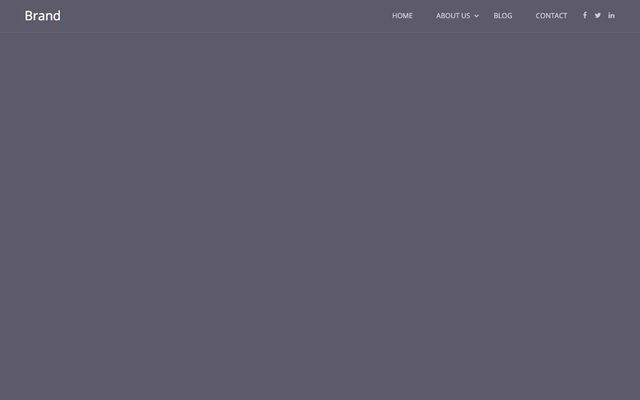</a> <b>Website Menu 01</b> <a href="https://preview.colorlib.com/#website-menu-01">Demo</a> · <a href="website-menu-01/">Code</a> · <a href="https://colorlib.com/wp/template/website-menu-01/">Details</a></td>
<td align="center" width="33%"><a href="https://preview.colorlib.com/#website-menu-02">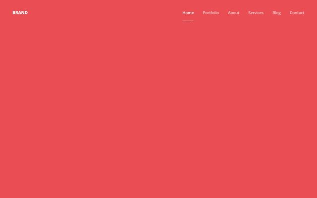</a> <b>Website Menu 02</b> <a href="https://preview.colorlib.com/#website-menu-02">Demo</a> · <a href="website-menu-02/">Code</a> · <a href="https://colorlib.com/wp/template/website-menu-02/">Details</a></td>
<td align="center" width="33%"><a href="https://preview.colorlib.com/#website-menu-03">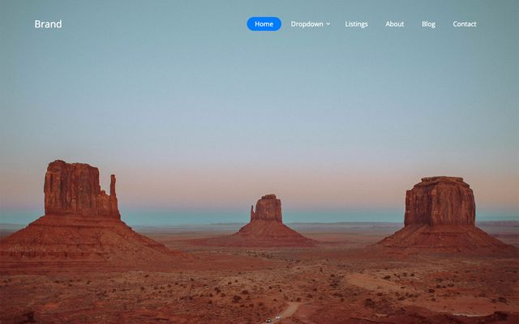</a> <b>Website Menu 03</b> <a href="https://preview.colorlib.com/#website-menu-03">Demo</a> · <a href="website-menu-03/">Code</a> · <a href="https://colorlib.com/wp/template/website-menu-03/">Details</a></td>
</tr>
<tr>
<td align="center" width="33%"><a href="https://preview.colorlib.com/#website-menu-04">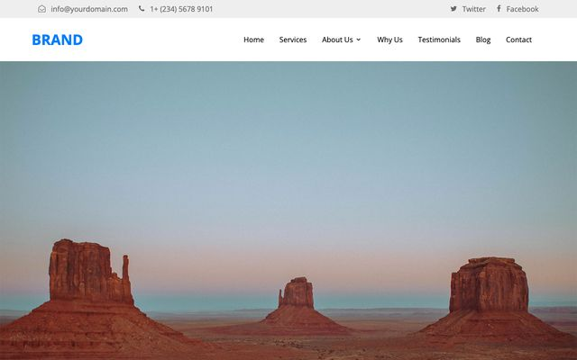</a> <b>Website Menu 04</b> <a href="https://preview.colorlib.com/#website-menu-04">Demo</a> · <a href="website-menu-04/">Code</a> · <a href="https://colorlib.com/wp/template/website-menu-04/">Details</a></td>
<td align="center" width="33%"> <b>Website Menu 05</b> <a href="https://preview.colorlib.com/#website-menu-05">Demo</a> · <a href="website-menu-05/">Code</a> · <a href="https://colorlib.com/wp/template/website-menu-05/">Details</a></td>
<td align="center" width="33%"> <b>Website Menu 06</b> <a href="https://preview.colorlib.com/#website-menu-06">Demo</a> · <a href="website-menu-06/">Code</a> · <a href="https://colorlib.com/wp/template/website-menu-06/">Details</a></td>
</tr>
<tr>
<td align="center" width="33%"><a href="https://preview.colorlib.com/#website-menu-07">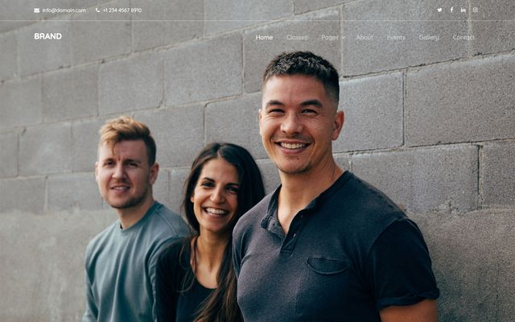</a> <b>Website Menu 07</b> <a href="https://preview.colorlib.com/#website-menu-07">Demo</a> · <a href="website-menu-07/">Code</a> · <a href="https://colorlib.com/wp/template/website-menu-07/">Details</a></td>
<td align="center" width="33%"><a href="https://preview.colorlib.com/#website-menu-08">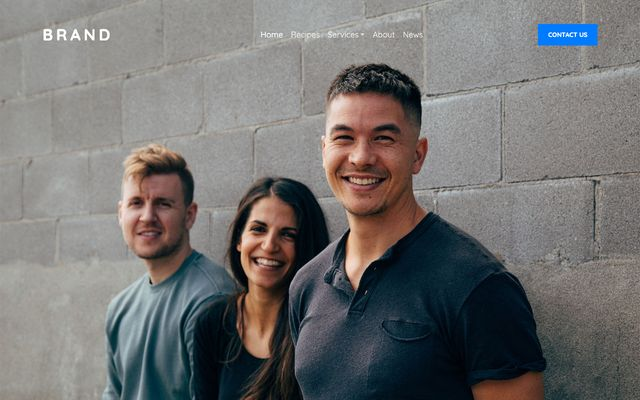</a> <b>Website Menu 08</b> <a href="https://preview.colorlib.com/#website-menu-08">Demo</a> · <a href="website-menu-08/">Code</a> · <a href="https://colorlib.com/wp/template/website-menu-08/">Details</a></td>
<td align="center" width="33%"><a href="https://preview.colorlib.com/#website-menu-09">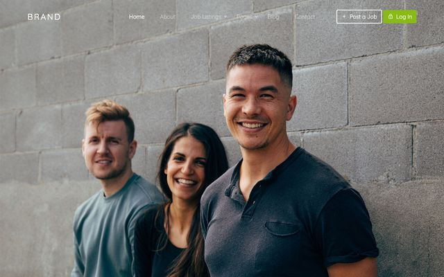</a> <b>Website Menu 09</b> <a href="https://preview.colorlib.com/#website-menu-09">Demo</a> · <a href="website-menu-09/">Code</a> · <a href="https://colorlib.com/wp/template/website-menu-09/">Details</a></td>
</tr>
<tr>
<td align="center" width="33%"><a href="https://preview.colorlib.com/#website-menu-10">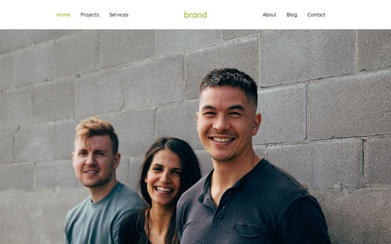</a> <b>Website Menu 10</b> <a href="https://preview.colorlib.com/#website-menu-10">Demo</a> · <a href="website-menu-10/">Code</a> · <a href="https://colorlib.com/wp/template/website-menu-10/">Details</a></td>
<td align="center" width="33%"><a href="https://preview.colorlib.com/#website-menu-11">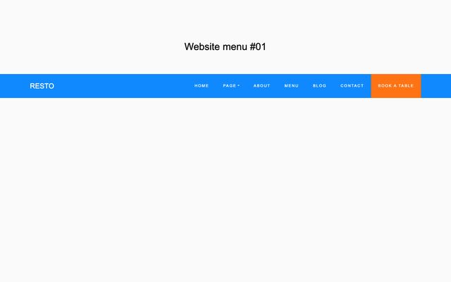</a> <b>Website Menu 11</b> <a href="https://preview.colorlib.com/#website-menu-11">Demo</a> · <a href="website-menu-11/">Code</a> · <a href="https://colorlib.com/wp/template/website-menu-11/">Details</a></td>
<td align="center" width="33%"><a href="https://preview.colorlib.com/#website-menu-12">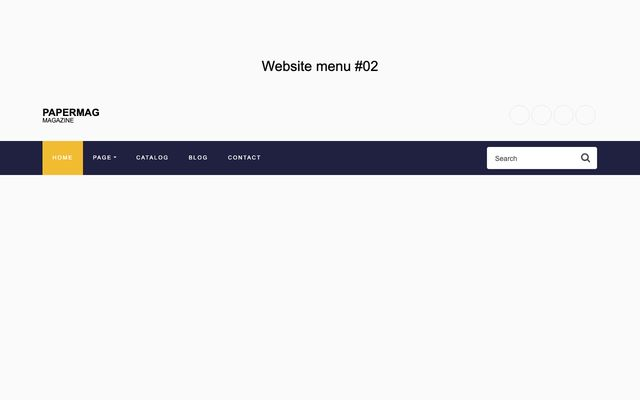</a> <b>Website Menu 12</b> <a href="https://preview.colorlib.com/#website-menu-12">Demo</a> · <a href="website-menu-12/">Code</a> · <a href="https://colorlib.com/wp/template/website-menu-12/">Details</a></td>
</tr>
<tr>
<td align="center" width="33%"><a href="https://preview.colorlib.com/#website-menu-13">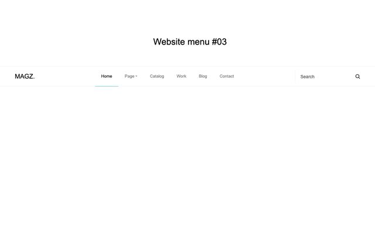</a> <b>Website Menu 13</b> <a href="https://preview.colorlib.com/#website-menu-13">Demo</a> · <a href="website-menu-13/">Code</a> · <a href="https://colorlib.com/wp/template/website-menu-13/">Details</a></td>
<td align="center" width="33%"><a href="https://preview.colorlib.com/#website-menu-14">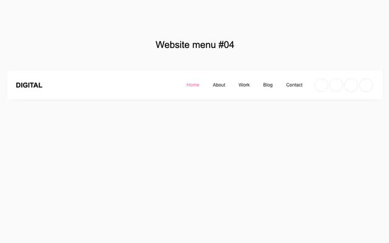</a> <b>Website Menu 14</b> <a href="https://preview.colorlib.com/#website-menu-14">Demo</a> · <a href="website-menu-14/">Code</a> · <a href="https://colorlib.com/wp/template/website-menu-14/">Details</a></td>
<td align="center" width="33%"><a href="https://preview.colorlib.com/#website-menu-15">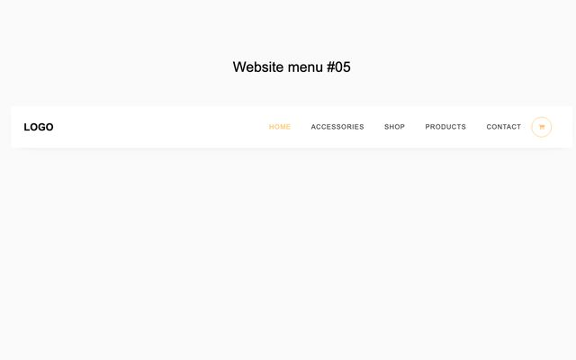</a> <b>Website Menu 15</b> <a href="https://preview.colorlib.com/#website-menu-15">Demo</a> · <a href="website-menu-15/">Code</a> · <a href="https://colorlib.com/wp/template/website-menu-15/">Details</a></td>
</tr>
<tr>
<td align="center" width="33%"><a href="https://preview.colorlib.com/#website-menu-16">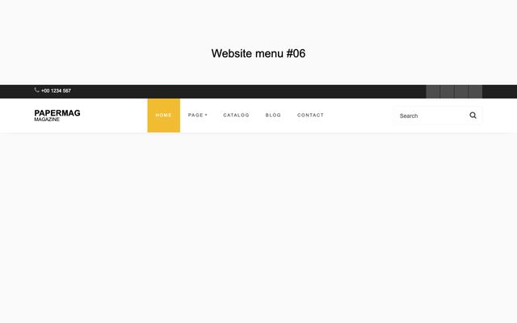</a> <b>Website Menu 16</b> <a href="https://preview.colorlib.com/#website-menu-16">Demo</a> · <a href="website-menu-16/">Code</a> · <a href="https://colorlib.com/wp/template/website-menu-16/">Details</a></td>
<td align="center" width="33%"><a href="https://preview.colorlib.com/#website-menu-17">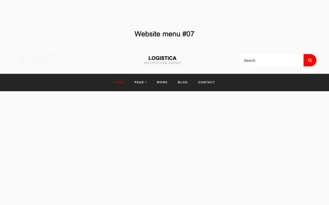</a> <b>Website Menu 17</b> <a href="https://preview.colorlib.com/#website-menu-17">Demo</a> · <a href="website-menu-17/">Code</a> · <a href="https://colorlib.com/wp/template/website-menu-17/">Details</a></td>
<td align="center" width="33%"><a href="https://preview.colorlib.com/#website-menu-18">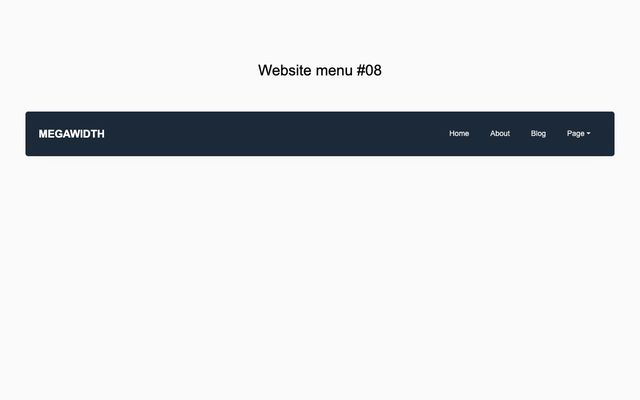</a> <b>Website Menu 18</b> <a href="https://preview.colorlib.com/#website-menu-18">Demo</a> · <a href="website-menu-18/">Code</a> · <a href="https://colorlib.com/wp/template/website-menu-18/">Details</a></td>
</tr>
<tr>
<td align="center" width="33%"><a href="https://preview.colorlib.com/#website-menu-19">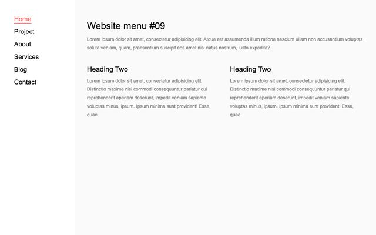</a> <b>Website Menu 19</b> <a href="https://preview.colorlib.com/#website-menu-19">Demo</a> · <a href="website-menu-19/">Code</a> · <a href="https://colorlib.com/wp/template/website-menu-19/">Details</a></td>
<td align="center" width="33%"><a href="https://preview.colorlib.com/#website-menu-20">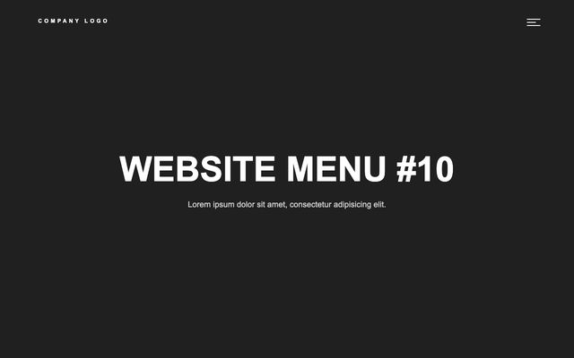</a> <b>Website Menu 20</b> <a href="https://preview.colorlib.com/#website-menu-20">Demo</a> · <a href="website-menu-20/">Code</a> · <a href="https://colorlib.com/wp/template/website-menu-20/">Details</a></td>
</tr>
</table>

## Bootstrap sidebars

<table>
<tr>
<td align="center" width="33%"><a href="https://preview.colorlib.com/#bootstrap-sidebar-01">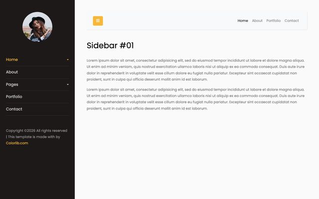</a> <b>Bootstrap Sidebar 01</b> <a href="https://preview.colorlib.com/#bootstrap-sidebar-01">Demo</a> · <a href="bootstrap-sidebar-01/">Code</a> · <a href="https://colorlib.com/wp/template/bootstrap-sidebar-01/">Details</a></td>
<td align="center" width="33%"><a href="https://preview.colorlib.com/#bootstrap-sidebar-02">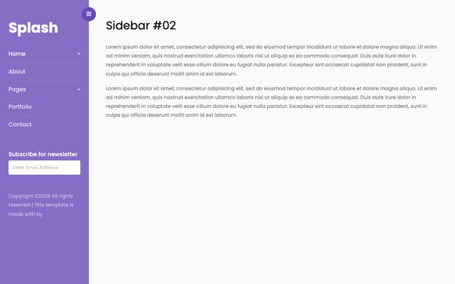</a> <b>Bootstrap Sidebar 02</b> <a href="https://preview.colorlib.com/#bootstrap-sidebar-02">Demo</a> · <a href="bootstrap-sidebar-02/">Code</a> · <a href="https://colorlib.com/wp/template/bootstrap-sidebar-02/">Details</a></td>
<td align="center" width="33%"><a href="https://preview.colorlib.com/#bootstrap-sidebar-03">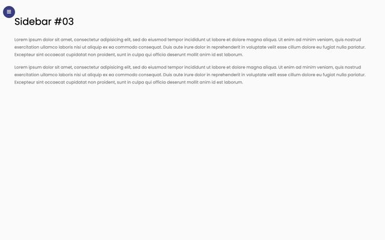</a> <b>Bootstrap Sidebar 03</b> <a href="https://preview.colorlib.com/#bootstrap-sidebar-03">Demo</a> · <a href="bootstrap-sidebar-03/">Code</a> · <a href="https://colorlib.com/wp/template/bootstrap-sidebar-03/">Details</a></td>
</tr>
<tr>
<td align="center" width="33%"><a href="https://preview.colorlib.com/#bootstrap-sidebar-04">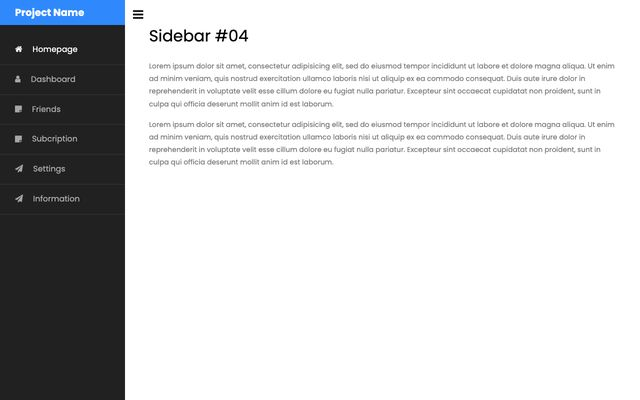</a> <b>Bootstrap Sidebar 04</b> <a href="https://preview.colorlib.com/#bootstrap-sidebar-04">Demo</a> · <a href="bootstrap-sidebar-04/">Code</a> · <a href="https://colorlib.com/wp/template/bootstrap-sidebar-04/">Details</a></td>
<td align="center" width="33%"><a href="https://preview.colorlib.com/#bootstrap-sidebar-05">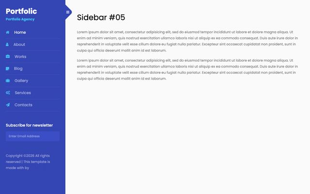</a> <b>Bootstrap Sidebar 05</b> <a href="https://preview.colorlib.com/#bootstrap-sidebar-05">Demo</a> · <a href="bootstrap-sidebar-05/">Code</a> · <a href="https://colorlib.com/wp/template/bootstrap-sidebar-05/">Details</a></td>
<td align="center" width="33%"><a href="https://preview.colorlib.com/#bootstrap-sidebar-06">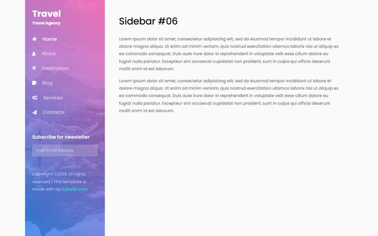</a> <b>Bootstrap Sidebar 06</b> <a href="https://preview.colorlib.com/#bootstrap-sidebar-06">Demo</a> · <a href="bootstrap-sidebar-06/">Code</a> · <a href="https://colorlib.com/wp/template/bootstrap-sidebar-06/">Details</a></td>
</tr>
<tr>
<td align="center" width="33%"><a href="https://preview.colorlib.com/#bootstrap-sidebar-07">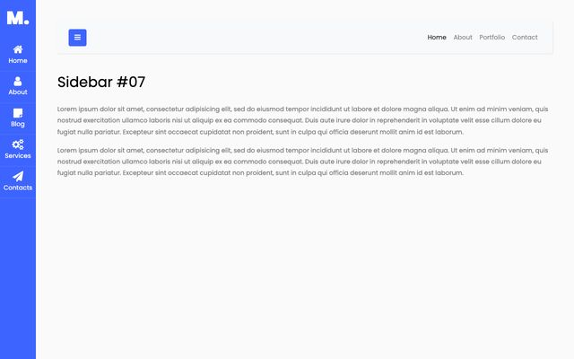</a> <b>Bootstrap Sidebar 07</b> <a href="https://preview.colorlib.com/#bootstrap-sidebar-07">Demo</a> · <a href="bootstrap-sidebar-07/">Code</a> · <a href="https://colorlib.com/wp/template/bootstrap-sidebar-07/">Details</a></td>
<td align="center" width="33%"><a href="https://preview.colorlib.com/#bootstrap-sidebar-08">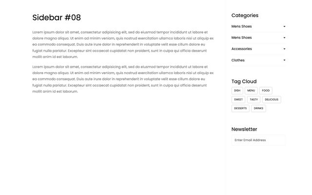</a> <b>Bootstrap Sidebar 08</b> <a href="https://preview.colorlib.com/#bootstrap-sidebar-08">Demo</a> · <a href="bootstrap-sidebar-08/">Code</a> · <a href="https://colorlib.com/wp/template/bootstrap-sidebar-08/">Details</a></td>
<td align="center" width="33%"><a href="https://preview.colorlib.com/#bootstrap-sidebar-09">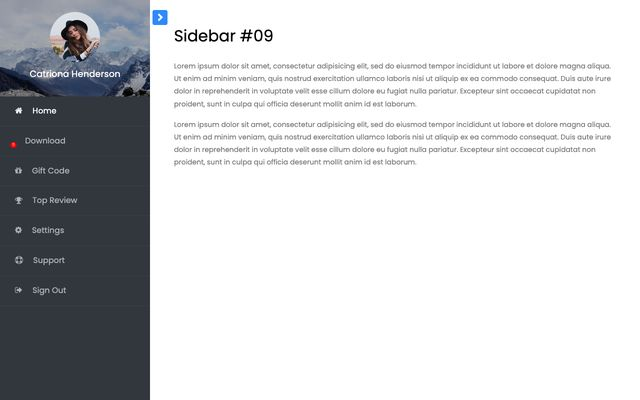</a> <b>Bootstrap Sidebar 09</b> <a href="https://preview.colorlib.com/#bootstrap-sidebar-09">Demo</a> · <a href="bootstrap-sidebar-09/">Code</a> · <a href="https://colorlib.com/wp/template/bootstrap-sidebar-09/">Details</a></td>
</tr>
<tr>
<td align="center" width="33%"><a href="https://preview.colorlib.com/#bootstrap-sidebar-10">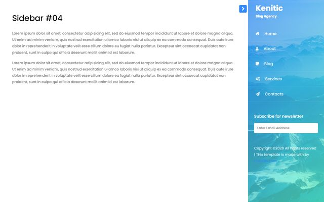</a> <b>Bootstrap Sidebar 10</b> <a href="https://preview.colorlib.com/#bootstrap-sidebar-10">Demo</a> · <a href="bootstrap-sidebar-10/">Code</a> · <a href="https://colorlib.com/wp/template/bootstrap-sidebar-10/">Details</a></td>
</tr>
</table>

## Sidebars

<table>
<tr>
<td align="center" width="33%"> <b>Sidebar V01</b> <a href="https://preview.colorlib.com/#colorlib-sidebar-v01">Demo</a> · <a href="colorlib-sidebar-v01/">Code</a> · <a href="https://colorlib.com/wp/template/colorlib-sidebar-v01/">Details</a></td>
<td align="center" width="33%"><a href="https://preview.colorlib.com/#colorlib-sidebar-v02">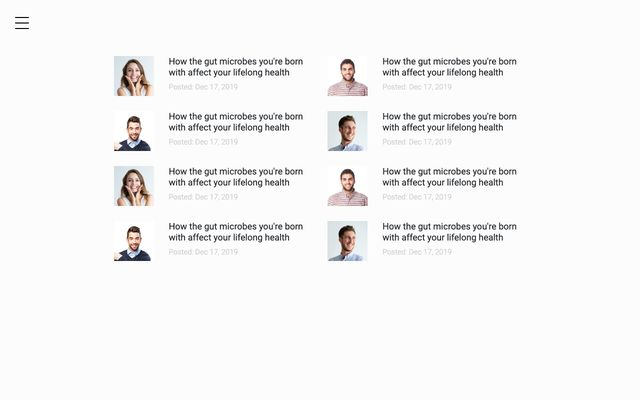</a> <b>Sidebar V02</b> <a href="https://preview.colorlib.com/#colorlib-sidebar-v02">Demo</a> · <a href="colorlib-sidebar-v02/">Code</a> · <a href="https://colorlib.com/wp/template/colorlib-sidebar-v02/">Details</a></td>
<td align="center" width="33%"><a href="https://preview.colorlib.com/#colorlib-sidebar-v03">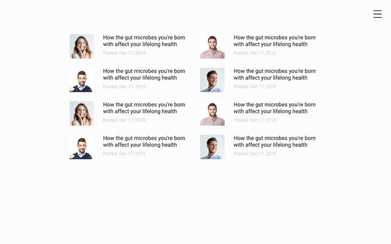</a> <b>Sidebar V03</b> <a href="https://preview.colorlib.com/#colorlib-sidebar-v03">Demo</a> · <a href="colorlib-sidebar-v03/">Code</a> · <a href="https://colorlib.com/wp/template/colorlib-sidebar-v03/">Details</a></td>
</tr>
<tr>
<td align="center" width="33%"><a href="https://preview.colorlib.com/#colorlib-sidebar-v04">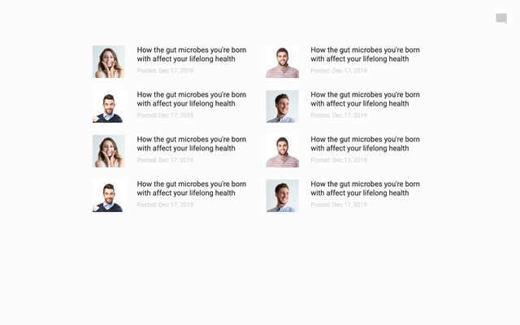</a> <b>Sidebar V04</b> <a href="https://preview.colorlib.com/#colorlib-sidebar-v04">Demo</a> · <a href="colorlib-sidebar-v04/">Code</a> · <a href="https://colorlib.com/wp/template/colorlib-sidebar-v04/">Details</a></td>
<td align="center" width="33%"> <b>Sidebar V05</b> <a href="https://preview.colorlib.com/#colorlib-sidebar-v05">Demo</a> · <a href="colorlib-sidebar-v05/">Code</a> · <a href="https://colorlib.com/wp/template/colorlib-sidebar-v05/">Details</a></td>
<td align="center" width="33%"><a href="https://preview.colorlib.com/#colorlib-sidebar-v06">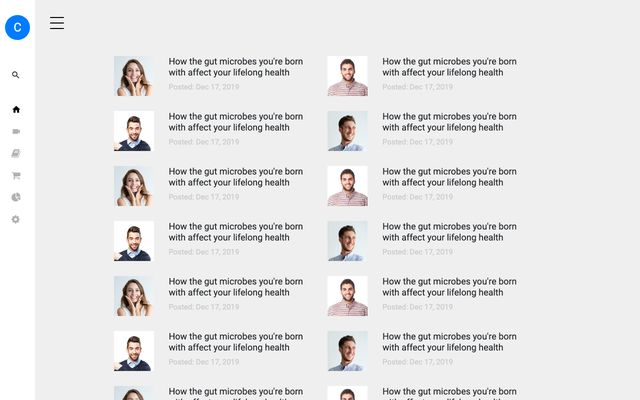</a> <b>Sidebar V06</b> <a href="https://preview.colorlib.com/#colorlib-sidebar-v06">Demo</a> · <a href="colorlib-sidebar-v06/">Code</a> · <a href="https://colorlib.com/wp/template/colorlib-sidebar-v06/">Details</a></td>
</tr>
<tr>
<td align="center" width="33%"><a href="https://preview.colorlib.com/#colorlib-sidebar-v07">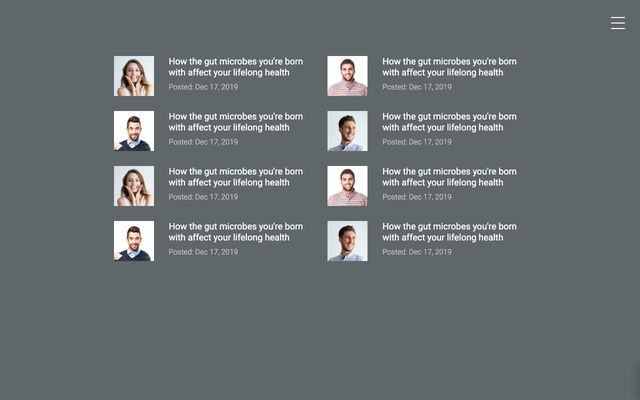</a> <b>Sidebar V07</b> <a href="https://preview.colorlib.com/#colorlib-sidebar-v07">Demo</a> · <a href="colorlib-sidebar-v07/">Code</a> · <a href="https://colorlib.com/wp/template/colorlib-sidebar-v07/">Details</a></td>
<td align="center" width="33%"> <b>Sidebar V08</b> <a href="https://preview.colorlib.com/#colorlib-sidebar-v08">Demo</a> · <a href="colorlib-sidebar-v08/">Code</a> · <a href="https://colorlib.com/wp/template/colorlib-sidebar-v08/">Details</a></td>
<td align="center" width="33%"><a href="https://preview.colorlib.com/#colorlib-sidebar-v09">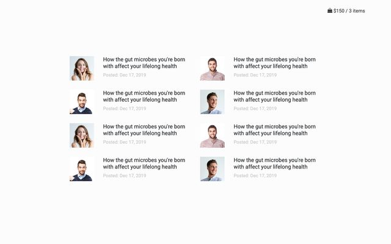</a> <b>Sidebar V09</b> <a href="https://preview.colorlib.com/#colorlib-sidebar-v09">Demo</a> · <a href="colorlib-sidebar-v09/">Code</a> · <a href="https://colorlib.com/wp/template/colorlib-sidebar-v09/">Details</a></td>
</tr>
<tr>
<td align="center" width="33%"> <b>Sidebar V10</b> <a href="https://preview.colorlib.com/#colorlib-sidebar-v10">Demo</a> · <a href="colorlib-sidebar-v10/">Code</a> · <a href="https://colorlib.com/wp/template/colorlib-sidebar-v10/">Details</a></td>
</tr>
</table>

## Dropdowns

<table>
<tr>
<td align="center" width="33%"><a href="https://preview.colorlib.com/#dropdown-01">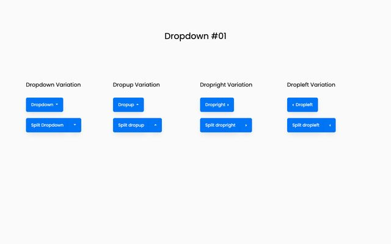</a> <b>Dropdown 01</b> <a href="https://preview.colorlib.com/#dropdown-01">Demo</a> · <a href="dropdown-01/">Code</a> · <a href="https://colorlib.com/wp/template/dropdown-01/">Details</a></td>
<td align="center" width="33%"><a href="https://preview.colorlib.com/#dropdown-02">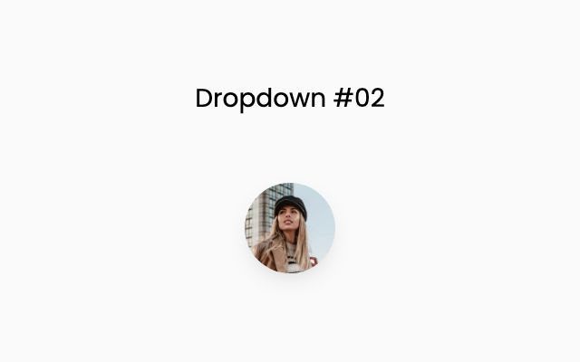</a> <b>Dropdown 02</b> <a href="https://preview.colorlib.com/#dropdown-02">Demo</a> · <a href="dropdown-02/">Code</a> · <a href="https://colorlib.com/wp/template/dropdown-02/">Details</a></td>
<td align="center" width="33%"><a href="https://preview.colorlib.com/#dropdown-03">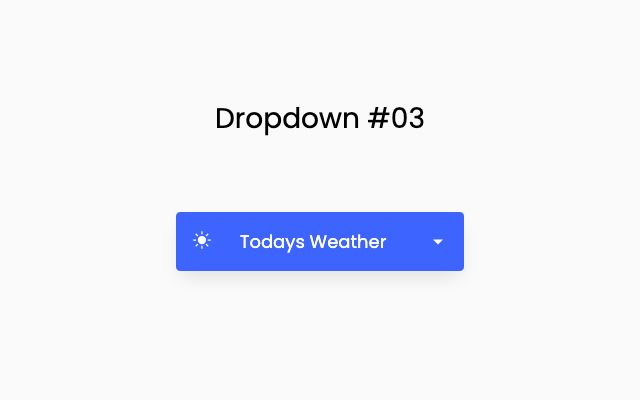</a> <b>Dropdown 03</b> <a href="https://preview.colorlib.com/#dropdown-03">Demo</a> · <a href="dropdown-03/">Code</a> · <a href="https://colorlib.com/wp/template/dropdown-03/">Details</a></td>
</tr>
<tr>
<td align="center" width="33%"><a href="https://preview.colorlib.com/#dropdown-04">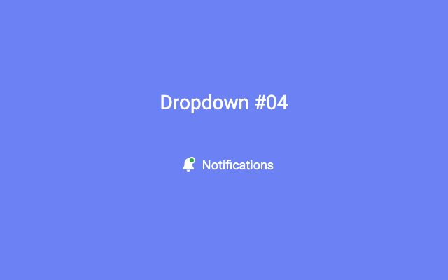</a> <b>Dropdown 04</b> <a href="https://preview.colorlib.com/#dropdown-04">Demo</a> · <a href="dropdown-04/">Code</a> · <a href="https://colorlib.com/wp/template/dropdown-04/">Details</a></td>
<td align="center" width="33%"><a href="https://preview.colorlib.com/#dropdown-05">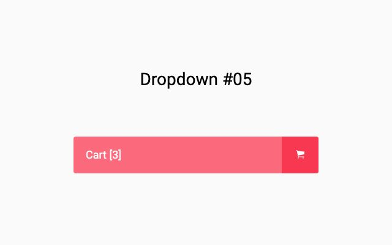</a> <b>Dropdown 05</b> <a href="https://preview.colorlib.com/#dropdown-05">Demo</a> · <a href="dropdown-05/">Code</a> · <a href="https://colorlib.com/wp/template/dropdown-05/">Details</a></td>
<td align="center" width="33%"><a href="https://preview.colorlib.com/#dropdown-06">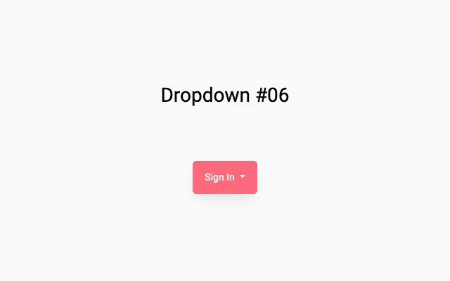</a> <b>Dropdown 06</b> <a href="https://preview.colorlib.com/#dropdown-06">Demo</a> · <a href="dropdown-06/">Code</a> · <a href="https://colorlib.com/wp/template/dropdown-06/">Details</a></td>
</tr>
<tr>
<td align="center" width="33%"><a href="https://preview.colorlib.com/#dropdown-07">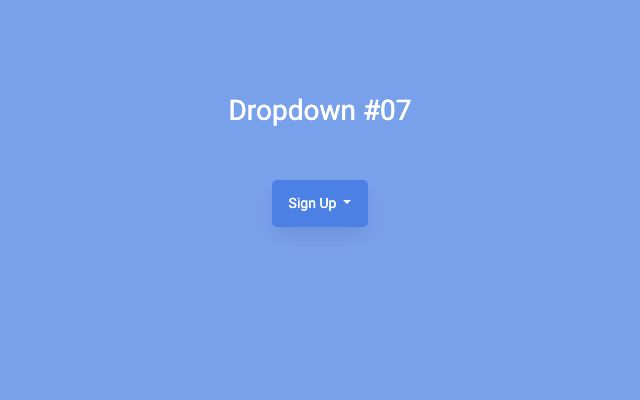</a> <b>Dropdown 07</b> <a href="https://preview.colorlib.com/#dropdown-07">Demo</a> · <a href="dropdown-07/">Code</a> · <a href="https://colorlib.com/wp/template/dropdown-07/">Details</a></td>
<td align="center" width="33%"><a href="https://preview.colorlib.com/#dropdown-08">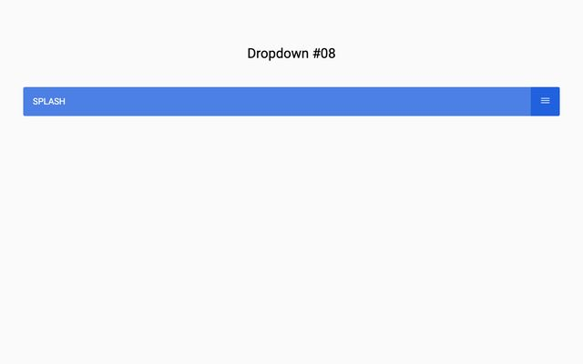</a> <b>Dropdown 08</b> <a href="https://preview.colorlib.com/#dropdown-08">Demo</a> · <a href="dropdown-08/">Code</a> · <a href="https://colorlib.com/wp/template/dropdown-08/">Details</a></td>
<td align="center" width="33%"><a href="https://preview.colorlib.com/#dropdown-09">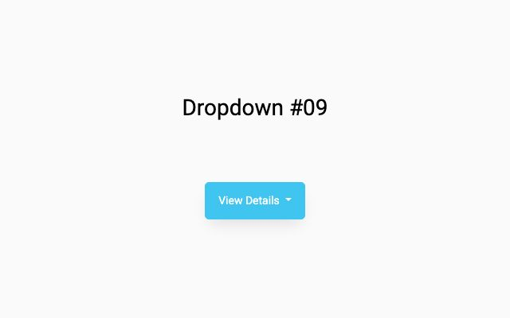</a> <b>Dropdown 09</b> <a href="https://preview.colorlib.com/#dropdown-09">Demo</a> · <a href="dropdown-09/">Code</a> · <a href="https://colorlib.com/wp/template/dropdown-09/">Details</a></td>
</tr>
<tr>
<td align="center" width="33%"><a href="https://preview.colorlib.com/#dropdown-10">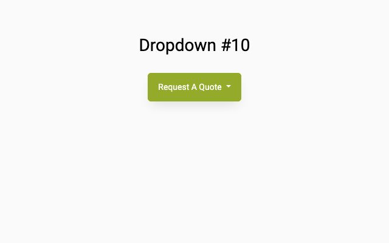</a> <b>Dropdown 10</b> <a href="https://preview.colorlib.com/#dropdown-10">Demo</a> · <a href="dropdown-10/">Code</a> · <a href="https://colorlib.com/wp/template/dropdown-10/">Details</a></td>
<td align="center" width="33%"><a href="https://preview.colorlib.com/#dropdown-11">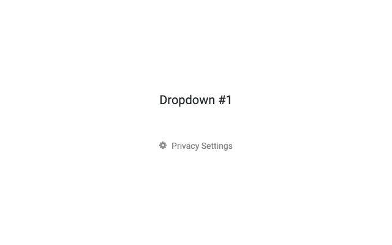</a> <b>Dropdown 11</b> <a href="https://preview.colorlib.com/#dropdown-11">Demo</a> · <a href="dropdown-11/">Code</a> · <a href="https://colorlib.com/wp/template/dropdown-11/">Details</a></td>
<td align="center" width="33%"><a href="https://preview.colorlib.com/#dropdown-12">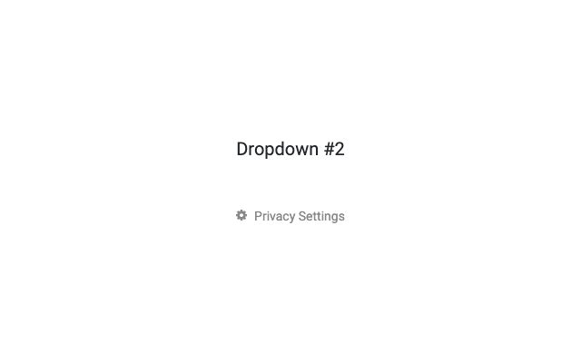</a> <b>Dropdown 12</b> <a href="https://preview.colorlib.com/#dropdown-12">Demo</a> · <a href="dropdown-12/">Code</a> · <a href="https://colorlib.com/wp/template/dropdown-12/">Details</a></td>
</tr>
<tr>
<td align="center" width="33%"><a href="https://preview.colorlib.com/#dropdown-13">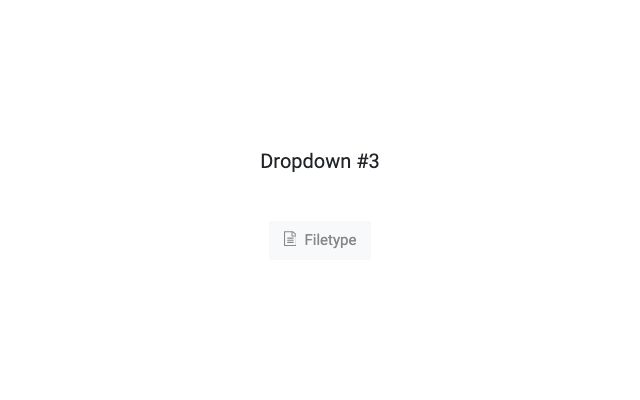</a> <b>Dropdown 13</b> <a href="https://preview.colorlib.com/#dropdown-13">Demo</a> · <a href="dropdown-13/">Code</a> · <a href="https://colorlib.com/wp/template/dropdown-13/">Details</a></td>
<td align="center" width="33%"><a href="https://preview.colorlib.com/#dropdown-14">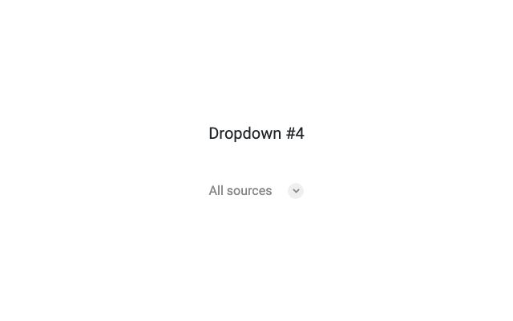</a> <b>Dropdown 14</b> <a href="https://preview.colorlib.com/#dropdown-14">Demo</a> · <a href="dropdown-14/">Code</a> · <a href="https://colorlib.com/wp/template/dropdown-14/">Details</a></td>
<td align="center" width="33%"><a href="https://preview.colorlib.com/#dropdown-15">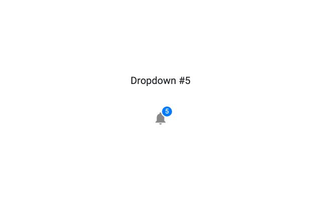</a> <b>Dropdown 15</b> <a href="https://preview.colorlib.com/#dropdown-15">Demo</a> · <a href="dropdown-15/">Code</a> · <a href="https://colorlib.com/wp/template/dropdown-15/">Details</a></td>
</tr>
<tr>
<td align="center" width="33%"> <b>Dropdown 16</b> <a href="https://preview.colorlib.com/#dropdown-16">Demo</a> · <a href="dropdown-16/">Code</a> · <a href="https://colorlib.com/wp/template/dropdown-16/">Details</a></td>
<td align="center" width="33%"><a href="https://preview.colorlib.com/#dropdown-17">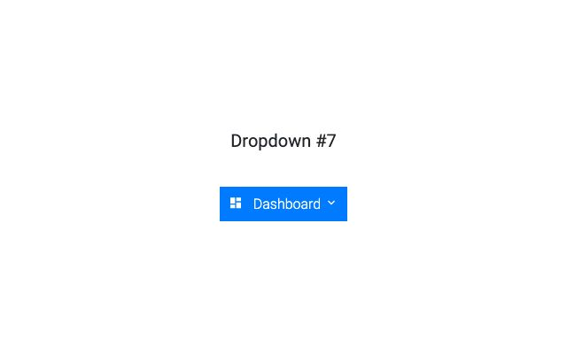</a> <b>Dropdown 17</b> <a href="https://preview.colorlib.com/#dropdown-17">Demo</a> · <a href="dropdown-17/">Code</a> · <a href="https://colorlib.com/wp/template/dropdown-17/">Details</a></td>
<td align="center" width="33%"> <b>Dropdown 18</b> <a href="https://preview.colorlib.com/#dropdown-18">Demo</a> · <a href="dropdown-18/">Code</a> · <a href="https://colorlib.com/wp/template/dropdown-18/">Details</a></td>
</tr>
<tr>
<td align="center" width="33%"> <b>Dropdown 19</b> <a href="https://preview.colorlib.com/#dropdown-19">Demo</a> · <a href="dropdown-19/">Code</a> · <a href="https://colorlib.com/wp/template/dropdown-19/">Details</a></td>
<td align="center" width="33%"> <b>Dropdown 20</b> <a href="https://preview.colorlib.com/#dropdown-20">Demo</a> · <a href="dropdown-20/">Code</a> · <a href="https://colorlib.com/wp/template/dropdown-20/">Details</a></td>
</tr>
</table>

## Offcanvas panels

<table>
<tr>
<td align="center" width="33%"> <b>Offcanvas 01</b> <a href="https://preview.colorlib.com/#offcanvas-01">Demo</a> · <a href="offcanvas-01/">Code</a> · <a href="https://colorlib.com/wp/template/offcanvas-01/">Details</a></td>
<td align="center" width="33%"> <b>Offcanvas 02</b> <a href="https://preview.colorlib.com/#offcanvas-02">Demo</a> · <a href="offcanvas-02/">Code</a> · <a href="https://colorlib.com/wp/template/offcanvas-02/">Details</a></td>
<td align="center" width="33%"> <b>Offcanvas 03</b> <a href="https://preview.colorlib.com/#offcanvas-03">Demo</a> · <a href="offcanvas-03/">Code</a> · <a href="https://colorlib.com/wp/template/offcanvas-03/">Details</a></td>
</tr>
<tr>
<td align="center" width="33%"> <b>Offcanvas 04</b> <a href="https://preview.colorlib.com/#offcanvas-04">Demo</a> · <a href="offcanvas-04/">Code</a> · <a href="https://colorlib.com/wp/template/offcanvas-04/">Details</a></td>
<td align="center" width="33%"> <b>Offcanvas 05</b> <a href="https://preview.colorlib.com/#offcanvas-05">Demo</a> · <a href="offcanvas-05/">Code</a> · <a href="https://colorlib.com/wp/template/offcanvas-05/">Details</a></td>
<td align="center" width="33%"> <b>Offcanvas 06</b> <a href="https://preview.colorlib.com/#offcanvas-06">Demo</a> · <a href="offcanvas-06/">Code</a> · <a href="https://colorlib.com/wp/template/offcanvas-06/">Details</a></td>
</tr>
<tr>
<td align="center" width="33%"> <b>Offcanvas 07</b> <a href="https://preview.colorlib.com/#offcanvas-07">Demo</a> · <a href="offcanvas-07/">Code</a> · <a href="https://colorlib.com/wp/template/offcanvas-07/">Details</a></td>
<td align="center" width="33%"> <b>Offcanvas 08</b> <a href="https://preview.colorlib.com/#offcanvas-08">Demo</a> · <a href="offcanvas-08/">Code</a> · <a href="https://colorlib.com/wp/template/offcanvas-08/">Details</a></td>
<td align="center" width="33%"> <b>Offcanvas 09</b> <a href="https://preview.colorlib.com/#offcanvas-09">Demo</a> · <a href="offcanvas-09/">Code</a> · <a href="https://colorlib.com/wp/template/offcanvas-09/">Details</a></td>
</tr>
<tr>
<td align="center" width="33%"> <b>Offcanvas 10</b> <a href="https://preview.colorlib.com/#offcanvas-10">Demo</a> · <a href="offcanvas-10/">Code</a> · <a href="https://colorlib.com/wp/template/offcanvas-10/">Details</a></td>
</tr>
</table>

## How to use one

1. Clone the repo, or download it as a ZIP from the green **Code** button.
2. Copy the folder of the template you want into your project.
3. Open its `index.html` in a browser. Every folder is self-contained: `css/style.css`, a small `js/snippet.js` where the template needs behaviour, plus its own fonts and images.

Using Bootstrap already? Load the template's `css/style.css` after your framework stylesheet. Class names are namespaced per template, so they won't collide with yours.

## License

Free for personal and commercial use, including client work. Attribution is appreciated but not required. Photography, where present, is licensed for use inside these templates. See [LICENSE.md](LICENSE.md).

## More free templates from Colorlib

- [Free HTML & CSS Login Form Templates](https://github.com/ColorlibHQ/login-form-templates)
- [Free HTML & CSS Registration Form Templates](https://github.com/ColorlibHQ/registration-form-templates)
- [Free Coming Soon & Under Construction Page Templates](https://github.com/ColorlibHQ/coming-soon-page-templates)
- [Free HTML & CSS Contact Form Templates](https://github.com/ColorlibHQ/contact-form-templates)
- [Free 404 & Error Page Templates](https://github.com/ColorlibHQ/404-error-page-templates)
- [Free Multi-Step Form & Form Wizard Templates](https://github.com/ColorlibHQ/multi-step-form-templates)
- [Free Booking & Appointment Form Templates](https://github.com/ColorlibHQ/booking-form-templates)
- [Free HTML & CSS Search Form Templates](https://github.com/ColorlibHQ/search-form-templates)
- [Free HTML & CSS Table Templates](https://github.com/ColorlibHQ/html-table-templates)
- [Free HTML Form Templates: Job Application, Survey & Newsletter](https://github.com/ColorlibHQ/html-form-templates)
- [Free HTML & CSS UI Components](https://github.com/ColorlibHQ/html-css-ui-components)

Building an admin panel or a web app?

- [Gentelella](https://github.com/ColorlibHQ/gentelella) and [Adminator](https://github.com/puikinsh/Adminator-admin-dashboard): free admin dashboard templates
- [DashboardPack](https://dashboardpack.com/templates/?utm_source=github&utm_medium=readme&utm_campaign=navigation-menu-templates): premium dashboards for React, Vue, Angular, Next.js, Laravel and plain HTML

Made by [Colorlib](https://colorlib.com/).
